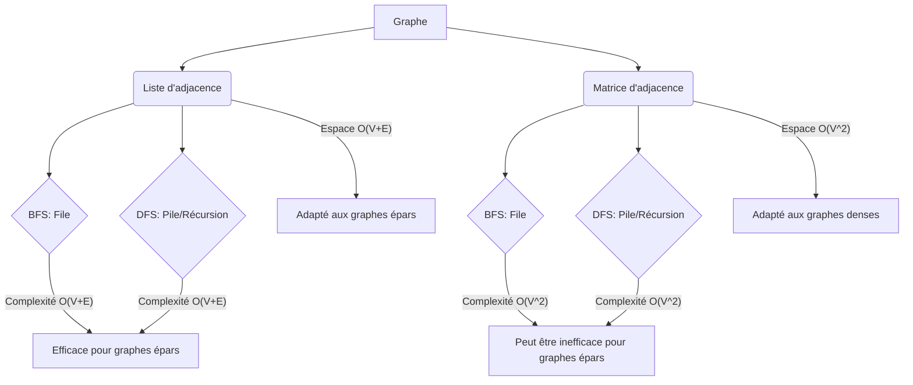

<DiagnosticQuiz question="Étant donné un graphe non orienté représenté par une liste d'adjacence, quelle structure de données est la plus appropriée pour implémenter efficacement l'algorithme de parcours en largeur (BFS) et pourquoi, en considérant la complexité temporelle ?" options="Une pile (stack) car elle permet une exploration en profondeur.|||Une file (queue) car elle maintient l'ordre d'arrivée des sommets, essentiel pour explorer niveau par niveau.|||Un tableau associatif (hash map) pour stocker les sommets visités.|||Un arbre binaire de recherche pour gérer les sommets à visiter." correctIndex="1" targetSectionId="parcours-largeur" sectionTitle="Algorithme de Parcours en Largeur (BFS)" />

## Introduction aux Algorithmes de Parcours
L'exploration systématique des structures de données est une pierre angulaire de l'informatique, et parmi les structures les plus omniprésentes et les plus étudiées, les graphes occupent une place prépondérante. Les graphes, composés de sommets (ou nœuds) et d'arêtes (ou liens), modélisent une vaste gamme de phénomènes du monde réel, allant des réseaux sociaux et des réseaux routiers aux circuits électroniques et aux structures moléculaires. Comprendre comment naviguer et interroger efficacement ces structures est donc d'une importance capitale. C'est là qu'interviennent les algorithmes de parcours.

Un algorithme de parcours de graphe est une procédure systématique qui visite chaque sommet d'un graphe exactement une fois, en suivant les arêtes. Cette visite ordonnée permet de découvrir la structure du graphe, d'identifier des chemins, de détecter des cycles, de trouver des composantes connexes, et de résoudre une multitude d'autres problèmes algorithmiques. Sans une méthode de parcours bien définie, l'analyse et la manipulation des graphes deviendraient rapidement ingérables, même pour des structures de taille modeste. La conception et l'analyse de ces algorithmes sont donc fondamentales pour le développement de logiciels performants et la résolution de problèmes complexes dans divers domaines de l'informatique et au-delà <Reference id="1" name="1" term="1">1</Reference>.

Dans cette leçon, nous allons nous concentrer sur deux des algorithmes de parcours de graphes les plus fondamentaux et les plus largement utilisés : le Parcours en Largeur (Breadth-First Search, BFS) et le Parcours en Profondeur (Depth-First Search, DFS). Bien que leurs objectifs finaux soient similaires – explorer le graphe – leurs stratégies de visite diffèrent radicalement, menant à des applications distinctes et à des propriétés uniques. Nous étudierons en détail le fonctionnement de chacun, leur complexité, et leurs cas d'utilisation typiques.

Les objectifs d'apprentissage de cette leçon sont les suivants :
* Comprendre le principe général des algorithmes de parcours de graphes et leur importance.
* Maîtriser le fonctionnement de l'algorithme de Parcours en Largeur (BFS), y compris son utilisation d'une file d'attente.
* analyser la complexité temporelle et spatiale de BFS.
* Identifier des exemples concrets d'application de BFS.
* Comprendre le principe général de l'algorithme de Parcours en Profondeur (DFS) et son utilisation d'une pile (implicite ou explicite).
* analyser la complexité temporelle et spatiale de DFS.
* Identifier des exemples concrets d'application de DFS.
* Comparer les approches BFS et DFS et comprendre quand privilégier l'une par rapport à l'autre.

<Image description="Ce schéma illustre les deux principales stratégies de parcours de graphes : la recherche en largeur (BFS) et la recherche en profondeur (DFS). Il montre comment BFS explore le graphe niveau par niveau à l'aide d'une file, garantissant la découverte du plus court chemin dans les graphes non pondérés. En contraste, DFS explore aussi profondément que possible le long de chaque branche avant de revenir en arrière, utilisant une pile (implicite ou explicite) pour gérer les chemins à explorer. La visualisation met en évidence les structures de données clés et les chemins d'exploration distincts pour chaque algorithme." alt="Structure moléculaire en nid d'abeille de graphène, vue en perspective." caption="Figure 1: Structure moléculaire hexagonale de graphène en 3D sur fond gris. Source: [Wikimedia Commons](https://commons.wikimedia.org/wiki/File:Graphen.jpg)" title="Approches de Parcours de Graphes : BFS vs DFS" src="https://commons.wikimedia.org/wiki/Special:FilePath/Graphen.jpg" fallbackUrl="https://commons.wikimedia.org/wiki/File:Graphen.jpg" />

Comment ce schéma de parcours de graphe permet-il de visualiser concrètement la différence entre une exploration systématique par niveaux (largeur) et une exploration qui s'enfonce le plus loin possible le long d'un chemin avant de revenir en arrière (profondeur) ?

<Objectives>
  <Knowledge>
    <ul className="list-disc pl-4 space-y-1">
      <li>analyser les propriétés fondamentales des algorithmes de parcours de graphes (BFS et DFS).</li>
      <li>Évaluer la complexité temporelle et spatiale des algorithmes de parcours sur différentes représentations de graphes.</li>
      <li>Synthétiser les applications concrètes des algorithmes de parcours dans divers domaines informatiques.</li>
    </ul>
  </Knowledge>
  <Skills>
    <ul className="list-disc pl-4 space-y-1">
      <li>Concevoir et implémenter des algorithmes de parcours (BFS, DFS) en utilisant des structures de données appropriées (files, piles).</li>
      <li>Comparer et contraster les performances des algorithmes de parcours pour résoudre des problèmes spécifiques.</li>
      <li>Déboguer et optimiser des implémentations d'algorithmes de parcours pour améliorer leur efficacité.</li>
    </ul>
  </Skills>
  <Attitudes>
    <ul className="list-disc pl-4 space-y-1">
      <li>Adopter une démarche rigoureuse dans l'analyse de la complexité des algorithmes.</li>
      <li>Développer une pensée critique face au choix des structures de données et des algorithmes pour des problèmes donnés.</li>
      <li>Apprécier l'élégance et la puissance des algorithmes de parcours comme outils fondamentaux en informatique.</li>
    </ul>
  </Attitudes>
</Objectives>

## Parcours en Largeur (BFS)

Le Parcours en Largeur, ou BFS (Breadth-First Search), est un algorithme de parcours de graphes qui explore le graphe niveau par niveau. Il commence à un sommet source donné et explore d'abord tous les voisins de ce sommet, puis tous les voisins de ces voisins, et ainsi de suite. Cette stratégie garantit que tous les sommets à une distance *k* du sommet source sont visités avant tout sommet à une distance *k+1*. L'outil fondamental qui permet à BFS de maintenir cet ordre de visite est une <Glossary definition="Une structure de données de type FIFO (First-In, First-Out) utilisée par BFS pour stocker les sommets à visiter." id="file_d_attente" language="en" title="File d'attente">File d'attente</Glossary>.

Le fonctionnement de BFS peut être décrit par les étapes suivantes, en partant d'un sommet source *s* :

1. **Initialisation :**
 * Créer une file d'attente, disons `Q`.
 * Marquer tous les sommets du graphe comme non visités.
 * Marquer le sommet source *s* comme visité et l'ajouter à la file d'attente `Q`.

2. **Boucle de Parcours :**
 * Tant que la file d'attente `Q` n'est pas vide :
 * Détacher le premier sommet de la file d'attente `Q` et le désigner comme sommet courant, disons *u*.
 * Pour chaque voisin *v* du sommet courant *u* :
 * Si le sommet *v* n'a pas encore été visité :
 * Marquer *v* comme visité.
 * Ajouter *v* à la fin de la file d'attente `Q`.

Cette procédure garantit que les sommets sont explorés dans l'ordre de leur distance croissante par rapport au sommet source. La file d'attente agit comme un mécanisme de « premier entré, premier sorti » (FIFO), assurant que les sommets découverts en premier (ceux les plus proches de la source) sont traités avant ceux découverts plus tard.

La complexité temporelle de BFS est généralement exprimée en fonction du nombre de sommets *V* et du nombre d'arêtes *E* du graphe. Chaque sommet est ajouté à la file d'attente et retiré de celle-ci exactement une fois. Pour chaque sommet retiré, nous examinons toutes ses arêtes sortantes. Si le graphe est représenté par une, l'examen des voisins d'un sommet prend un temps proportionnel à son degré. La somme des degrés de tous les sommets est égale à 2*E* (pour un graphe non orienté). Par conséquent, la complexité temporelle totale est O(V + E).

La complexité spatiale de BFS est principalement déterminée par la taille maximale que peut atteindre la file d'attente et par l'espace nécessaire pour stocker l'état de visite de chaque sommet. Dans le pire des cas, la file d'attente peut contenir tous les sommets d'un niveau, ce qui peut être jusqu'à O(V) sommets. L'espace pour marquer les sommets visités est également O(V). Ainsi, la complexité spatiale est O(V).

BFS trouve de nombreuses applications pratiques. L'une des plus fondamentales est la recherche du plus court chemin dans un graphe non pondéré. En effet, puisque BFS explore le graphe niveau par niveau, le premier chemin trouvé vers un sommet donné est nécessairement le plus court en termes de nombre d'arêtes. C'est pourquoi BFS est souvent utilisé dans des algorithmes de routage réseau, où il permet de trouver le chemin le plus court entre deux points.

Un autre exemple d'application est la découverte des composantes connexes d'un graphe. En exécutant BFS à partir d'un sommet non visité, on peut identifier tous les sommets atteignables depuis ce sommet, formant ainsi une composante connexe. En répétant ce processus pour tous les sommets non visités, on peut trouver toutes les composantes connexes d'un graphe.

Considérons un exemple simple : un réseau social où les sommets représentent des personnes et les arêtes représentent des relations d'amitié. Si nous voulons trouver toutes les personnes qui sont à deux degrés de séparation de nous (nos amis d'amis), BFS est l'algorithme idéal. En partant de notre sommet, BFS visiterait d'abord tous nos amis directs (distance 1), puis tous leurs amis qui ne sont pas déjà nos amis directs (distance 2).

<Mermaid caption="Figure 2 : " chart={``} />

Comment ce diagramme de flux de BFS illustre-t-il le rôle de la file d'attente dans la gestion de l'ordre d'exploration des sommets ?

L'algorithme BFS a été formalisé et largement étudié par des pionniers de l'informatique comme <RealPerson id="edgar_dijkstra" name="Edsger W. Dijkstra" title="Edsger W. Dijkstra">Edsger W. Dijkstra</RealPerson>, bien que le concept remonte à des travaux antérieurs. Son élégance réside dans sa simplicité et son efficacité pour résoudre des problèmes liés à la distance minimale dans les graphes non pondérés.

<SolvedExercise title="Trouver le Plus Court Chemin avec BFS" solution="">
  
</SolvedExercise>

## Parcours en Profondeur (DFS)
Alors que le parcours en largeur (BFS) explore un graphe niveau par niveau, le parcours en profondeur (DFS) adopte une stratégie différente : il s'enfonce aussi loin que possible le long de chaque branche avant de revenir en arrière. L'algorithme DFS peut être conceptualisé comme une exploration systématique où, à partir d'un sommet de départ, on choisit un voisin non visité et on répète le processus récursivement. Si tous les voisins d'un sommet ont été visités, l'algorithme « revient en arrière » (backtracks) au sommet précédent et continue l'exploration à partir de là. Cette approche est intrinsèquement liée à l'utilisation d'une <Glossary id="pile" language="en" title="Pile">Pile</Glossary> (pile), qui gère l'ordre des sommets à visiter et le retour en arrière. La pile peut être gérée explicitement par le programmeur, ou implicitement par la pile d'appels de fonctions si l'algorithme est implémenté de manière récursive.

Le fonctionnement étape par étape du DFS est le suivant :

1. **Initialisation :** Marquer tous les sommets comme non visités.
2. **Choix d'un sommet de départ :** Sélectionner un sommet arbitraire (ou un sommet spécifié) comme point de départ.
3. **Exploration :**
 * Marquer le sommet courant comme visité.
 * Pour chaque voisin du sommet courant :
 * Si le voisin n'a pas été visité, appeler récursivement DFS sur ce voisin.
4. **Retour en arrière :** Si tous les voisins ont été visités, l'appel récursif se termine, et l'exécution retourne au sommet appelant.

Cette exploration peut être visualisée comme la descente dans un labyrinthe : on suit un chemin jusqu'à une impasse, puis on revient sur ses pas pour essayer un autre chemin.

La complexité temporelle du DFS est, comme pour le BFS, d'O(V + E), où V est le nombre de sommets et E le nombre d'arêtes. Chaque sommet est visité exactement une fois, et chaque arête est examinée au plus deux fois (une fois pour chaque direction dans un graphe non orienté, ou une fois dans un graphe orienté). La complexité spatiale est également O(V) dans le pire des cas, principalement due à la profondeur de la pile d'appels récursifs (ou de la pile explicite), qui peut être égale au nombre de sommets dans le cas d'un graphe en forme de chaîne <Reference id="2" name="2" term="2">2</Reference>.

Illustrons l'application du DFS avec un exemple concret. Considérons un graphe représentant un réseau de villes reliées par des routes. Si nous voulons trouver s'il existe un chemin entre deux villes, A et B, le DFS est une méthode efficace. En partant d'A, le DFS explorera une route, puis une autre, et ainsi de suite. Si B est atteint, nous savons qu'un chemin existe. Si une impasse est atteinte (une ville d'où toutes les routes mènent à des villes déjà visitées), le DFS reviendra en arrière pour explorer d'autres routes.

Un autre exemple classique est la détection de cycles dans un graphe. Pendant l'exécution du DFS, si nous rencontrons un sommet qui est déjà marqué comme « en cours de visite » (c'est-à-dire qu'il est dans la pile d'appels récursifs actuelle mais pas encore complètement exploré), cela indique la présence d'un cycle <Reference id="3" name="3" term="3">3</Reference>. Cette technique est fondamentale dans de nombreux domaines, de la vérification de programmes à la résolution de dépendances.

Le DFS est également à la base d'algorithmes plus complexes, comme le tri topologique, qui est utilisé pour ordonnancer des tâches ayant des dépendances. Dans un graphe orienté acyclique (DAG), le tri topologique produit une séquence linéaire des sommets telle que pour chaque arête orientée d'u à v, u apparaît avant v dans la séquence <Reference id="4" name="4" term="4">4</Reference>. Le DFS permet de construire cette séquence en enregistrant les sommets dans l'ordre inverse de leur achèvement.

<Image description="Cette image présente un exemple visuel de la manière dont l'algorithme de recherche en profondeur (DFS) explore un graphe. Elle met en évidence la stratégie d'exploration qui consiste à suivre un chemin aussi loin que possible avant de revenir en arrière (backtracking) pour explorer d'autres branches. Le chemin parcouru est souvent représenté par une couleur distincte, montrant la profondeur de la recherche avant de changer de direction." alt="Diagramme de flux illustrant l'algorithme d'Euclide pour trouver le plus grand commun diviseur de deux nombres." caption="Figure 2: Cette image présente un exemple visuel de la manière dont l'algorithme de recherche en profondeur (DFS) explore un graphe. Elle met en évidence la stratégie d'exploration qui consiste à suivre un chemin aussi loin que possible avant de revenir en arrière (backtracking) pour explorer d'autres branches. Le chemin parcouru est souvent représenté par une couleur distincte, montrant la profondeur de la recherche avant de changer de direction. Source: [Wikimedia Commons](https://commons.wikimedia.org/wiki/File:Euclid_flowchart_1.png)" title="Illustration du Parcours en Profondeur (DFS)" src="https://commons.wikimedia.org/wiki/Special:FilePath/Euclid_flowchart_1.png" fallbackUrl="https://commons.wikimedia.org/wiki/File:Euclid_flowchart_1.png" />

Comment la structure arborescente générée par le DFS aide-t-elle à visualiser les chemins d'exploration et les retours en arrière ?

L'algorithme DFS a été largement popularisé et analysé par des chercheurs comme <RealPerson id="robert_tarjan" name="Robert Tarjan" title="Robert Tarjan">Robert Tarjan</RealPerson>, dont les travaux sur les algorithmes de graphes ont eu un impact considérable <Reference id="5" name="5" term="5">5</Reference>.

<Mermaid caption="Figure 4 : " chart={``} />

Quel est le rôle de la pile d'appels implicite dans ce diagramme de flux du DFS récursif ?
## Applications des Algorithmes de Parcours
Les algorithmes de parcours, qu'il s'agisse du parcours en largeur (BFS) ou du parcours en profondeur (DFS), sont des outils fondamentaux en théorie des graphes et en informatique, ouvrant la voie à une multitude d'applications pratiques. Leur capacité à explorer systématiquement la structure d'un graphe les rend indispensables pour résoudre des problèmes complexes <Reference id="6" name="6" term="6">6</Reference>.

### Détection de cycles dans un graphe

La détection de cycles est une application directe et cruciale des algorithmes de parcours. Pour un graphe non orienté, le DFS est particulièrement adapté. Pendant l'exploration, si un sommet `v` est rencontré et qu'il est déjà visité, et que `v` n'est pas le parent immédiat du sommet courant dans l'arbre DFS, alors un cycle est détecté <Reference id="7" name="7" term="7">7</Reference>. Dans un graphe orienté, la détection de cycles avec DFS est légèrement différente : on utilise trois états pour les sommets : non visité, en cours de visite (dans la pile d'appels récursifs), et complètement visité. Si lors de l'exploration d'un sommet `u`, on rencontre un voisin `v` qui est dans l'état « en cours de visite », cela signifie qu'il existe un chemin de `v` à `u`, et comme il y a une arête de `u` à `v`, un cycle est formé <Reference id="8" name="8" term="8">8</Reference>. Le BFS peut également être adapté pour détecter des cycles, bien que ce soit moins direct que le DFS pour les graphes orientés. La détection de cycles est essentielle dans la compilation (pour les dépendances de code), la planification de tâches (pour éviter les boucles infinies) et la modélisation de systèmes dynamiques.

### Détermination des composantes connexes

Les composantes connexes sont des sous-graphes où deux sommets sont connectés par un chemin, et qui sont maximales en ce sens qu'aucun autre sommet du graphe ne peut être ajouté tout en maintenant cette propriété de connectivité. Pour un graphe non orienté, trouver toutes les composantes connexes est simple : on initialise tous les sommets comme non visités. On choisit un sommet non visité, on lance un parcours (BFS ou DFS) à partir de ce sommet, et tous les sommets atteints forment une composante connexe. On répète ce processus jusqu'à ce que tous les sommets soient visités.

Dans le cas des graphes orientés, on distingue les composantes fortement connexes (SCC - Strongly Connected Components) et les composantes faiblement connexes. Une composante faiblement connexe est un sous-graphe dont le graphe sous-jacent non orienté est connexe. Les composantes fortement connexes sont des sous-graphes où, pour toute paire de sommets `u` et `v` dans la composante, il existe un chemin de `u` à `v` ET un chemin de `v` à `u`. La découverte des SCC est un problème plus complexe qui peut être résolu efficacement en utilisant une combinaison de DFS, comme l'algorithme d'ou l'algorithme de Kosaraju. Ces algorithmes exploitent la structure des arbres DFS et des graphes transposés pour identifier les SCC. Les SCC sont importantes pour l'analyse de flux de contrôle, la modélisation de réseaux complexes et la compréhension de la structure intrinsèque des graphes orientés <Reference id="9" name="9" term="9">9</Reference>.

### Recherche de chemins

La recherche de chemins est l'une des applications les plus fondamentales. Le BFS est idéal pour trouver le plus court chemin dans un graphe non pondéré, car il explore le graphe couche par couche. Le premier chemin trouvé vers une destination est garanti d'être le plus court en termes de nombre d'arêtes. Pour les graphes pondérés, des algorithmes comme Dijkstra ou A* sont utilisés, qui s'appuient sur des principes similaires d'exploration mais avec une gestion plus sophistiquée des coûts. Le DFS peut également trouver un chemin, mais il ne garantit pas qu'il s'agisse du plus court. Cependant, sa capacité à explorer en profondeur peut être utile dans des scénarios où l'on cherche simplement à savoir si un chemin existe, ou pour explorer des chemins potentiels dans des espaces de recherche vastes.

### Aperçus sur des algorithmes plus avancés

Les algorithmes de parcours sont les briques élémentaires de nombreux algorithmes plus sophistiqués. Le **tri topologique**, mentionné précédemment, est un exemple parfait. Il s'applique aux graphes orientés acycliques (DAGs) et permet d'ordonner les sommets de manière à respecter les dépendances. Par exemple, pour planifier des tâches de construction, on doit s'assurer que les fondations sont posées avant les murs. Un DAG peut représenter ces dépendances, et un tri topologique donne l'ordre d'exécution des tâches. Le DFS est utilisé pour construire ce tri en enregistrant les sommets dans l'ordre inverse de leur fin d'exploration.

D'autres algorithmes avancés qui s'appuient sur les parcours incluent :

* **Algorithmes de flux maximum/minimum :** Des algorithmes comme Ford-Fulkerson utilisent des parcours (souvent BFS) pour trouver des chemins augmentants dans un réseau de flux.
* **Arbres couvrants minimaux (MST) :** Bien que des algorithmes comme Prim et Kruskal soient plus couramment utilisés, des approches basées sur des parcours peuvent être envisagées dans certains contextes.
* **Détection de ponts et de points d'articulation :** Des variantes du DFS permettent d'identifier les arêtes (ponts) ou les sommets (points d'articulation) dont la suppression augmenterait le nombre de composantes connexes. Ces éléments sont cruciaux pour l'analyse de la robustesse des réseaux.

L'étude approfondie des algorithmes de parcours ouvre la porte à la compréhension et à l'implémentation d'une vaste gamme de solutions algorithmiques pour des problèmes du monde réel.

<Quiz durationLimit={300} limit={3}>
 <Question q="Quel algorithme de parcours de graphe est idéal pour trouver le plus court chemin dans un graphe non pondéré ?" explanation="BFS explore le graphe niveau par niveau, garantissant que le premier chemin trouvé vers un nœud est le plus court en termes de nombre d'arêtes.">
  <Option text="Recherche en Profondeur (DFS)" correct={false} />
  <Option text="Recherche en Largeur (BFS)" correct={true} />
  <Option text="Algorithme de Dijkstra" correct={false} />
  <Option text="Algorithme de Bellman-Ford" correct={false} />
</Question>
 <Question q="Dans quel scénario l'utilisation de DFS est-elle plus appropriée que BFS ?" explanation="DFS est utile pour explorer en profondeur des structures comme les arbres ou pour trouver des chemins, car il suit une branche jusqu'à sa fin avant de revenir en arrière.">
  <Option text="Trouver le chemin le plus court entre deux nœuds." correct={false} />
  <Option text="Vérifier si un chemin existe entre deux nœuds." correct={false} />
  <Option text="Explorer toutes les branches possibles d'un arbre généalogique." correct={true} />
  <Option text="Cartographier les connexions réseau les plus proches." correct={false} />
</Question>
 <Question q="Quelle structure de données est principalement utilisée par l'algorithme BFS pour gérer les nœuds à visiter ?" explanation="BFS utilise une file pour maintenir l'ordre des nœuds à visiter, assurant une exploration niveau par niveau.">
  <Option text="Pile (Stack)" correct={false} />
  <Option text="File (Queue)" correct={true} />
  <Option text="File de priorité (Priority Queue)" correct={false} />
  <Option text="Tableau associatif (Table d'hachage)" correct={false} />
</Question>
</Quiz>

Comment la différence fondamentale entre BFS (exploration par niveau) et DFS (exploration en profondeur) influence-t-elle leur efficacité respective pour la détection de cycles dans les graphes orientés et non orientés ?

<SolvedExercise title="Découverte des Composantes Fortement Connexes avec l'Algorithme de Tarjan" solution="">
  
</SolvedExercise>

## Implémentations et Comparaisons

Les algorithmes de parcours en largeur (BFS) et en profondeur (DFS) peuvent être implémentés de diverses manières, le choix de la structure de données sous-jacente ayant un impact significatif sur leur performance. Les deux représentations de graphes les plus courantes sont la **liste d'adjacence** et la **matrice d'adjacence**.

La liste d'adjacence représente un graphe comme un tableau ou une carte où chaque clé correspond à un sommet, et la valeur associée est une liste des sommets voisins. Pour un graphe avec $V$ sommets et $E$ arêtes, la construction d'une liste d'adjacence prend généralement un temps de $O(V+E)$. L'accès aux voisins d'un sommet est efficace, prenant un temps proportionnel au degré du sommet.

La matrice d'adjacence, quant à elle, est une matrice $V \times V$ où l'élément $(i, j)$ est 1 si une arête existe entre le sommet $i$ et le sommet $j$, et 0 sinon. Sa construction prend $O(V^2)$ temps. L'avantage est l'accès en temps constant $O(1)$ pour vérifier l'existence d'une arête, mais l'inconvénient majeur est l'espace requis $O(V^2)$, qui peut être prohibitif pour les graphes épars (où $E \ll V^2$).

L'implémentation du BFS utilise typiquement une **file** (queue) pour gérer les sommets à visiter. Les sommets sont ajoutés à la file lorsqu'ils sont découverts, et retirés pour explorer leurs voisins. La complexité temporelle du BFS est $O(V+E)$ lorsqu'il est implémenté avec une liste d'adjacence, car chaque sommet et chaque arête est visité au plus une fois. Avec une matrice d'adjacence, la complexité devient $O(V^2)$ car pour chaque sommet, il faut parcourir toute une ligne de la matrice pour trouver ses voisins.

Le DFS, quant à lui, utilise généralement une **pile** (stack), soit explicitement, soit implicitement via la récursivité de la fonction d'appel. Les sommets sont empilés lorsqu'ils sont découverts et dépilés pour explorer en profondeur. Sa complexité temporelle est également $O(V+E)$ avec une liste d'adjacence, et $O(V^2)$ avec une matrice d'adjacence, pour des raisons similaires au BFS.

<Mermaid caption="Figure 5 : " chart={``} />

Les différences fondamentales entre BFS et DFS résident dans leur stratégie d'exploration. Le BFS explore le graphe niveau par niveau, garantissant que le premier chemin trouvé vers un sommet est le plus court en nombre d'arêtes dans un graphe non pondéré. Il est donc idéal pour trouver le plus court chemin, la détection de composantes connexes, et les problèmes de « plus proche voisin ». Le DFS explore aussi profondément que possible le long de chaque branche avant de revenir en arrière. Cette profondeur d'exploration le rend particulièrement utile pour la détection de cycles, le tri topologique, la recherche de chemins (sans garantie de minimalité), et l'exploration d'espaces de recherche complexes comme dans les jeux ou la résolution de puzzles.

En résumé, le choix entre BFS et DFS dépend fortement du problème à résoudre :

* **BFS est préféré pour :**
 * Trouver le plus court chemin dans un graphe non pondéré.
 * Trouver tous les nœuds à une distance k d'un nœud source.
 * Détection de composantes connexes.
 * Algorithmes de planification où l'exploration par étapes est cruciale.

* **DFS est préféré pour :**
 * Détection de cycles.
 * Tri topologique.
 * Trouver un chemin entre deux nœuds (sans garantie de minimalité).
 * Explorer des structures arborescentes ou des graphes avec de longues chaînes.
 * Implémentation d'algorithmes comme la recherche de composantes fortement connexes (SCC).

La capacité de BFS à garantir le plus court chemin dans les graphes non pondérés est une de ses propriétés les plus remarquables, directement liée à sa nature d'exploration par niveaux. Le DFS, par sa nature récursive ou basée sur une pile, peut potentiellement explorer des chemins très longs avant de trouver une solution, ce qui peut être coûteux en temps et en espace mémoire (pour la pile d'appels récursifs) dans le pire des cas, bien que sa complexité asymptotique reste la même que celle du BFS.

<Image description="Illustration conceptuelle comparant l'exploration par BFS et DFS sur un graphe simple." alt="Structure moléculaire hexagonale de graphène en 3D sur fond sombre." caption="Figure 3: conceptuelle comparant l'exploration par BFS et DFS sur un graphe simple. Source: [Wikimedia Commons](https://commons.wikimedia.org/wiki/File:Graphen.jpg)" src="https://commons.wikimedia.org/wiki/Special:FilePath/Graphen.jpg" fallbackUrl="https://commons.wikimedia.org/wiki/File:Graphen.jpg" />

Comment la structure en « bulle » de l'exploration BFS contraste-t-elle avec l'exploration en « branche » du DFS, et quelles implications cela a-t-il pour la découverte de chemins ?

<SolvedExercise title="Détection de Cycle dans un Graphe Orienté avec DFS" solution="">
  
</SolvedExercise>

## Conclusion
Au terme de cette exploration des algorithmes de parcours, nous avons consolidé notre compréhension des méthodes fondamentales pour naviguer systématiquement dans les structures de graphes : le parcours en largeur (BFS) et le parcours en profondeur (DFS). Nous avons vu que le BFS, utilisant une file, explore le graphe niveau par niveau, garantissant la

<WhatsNext itemsBase64="W10=" />
## Auto-évaluation

<Quiz durationLimit={1800}>
 <Question q="Quel algorithme de parcours de graphe explore systématiquement un chemin aussi loin que possible avant de revenir en arrière (backtracking) ?" explanation="La recherche en profondeur (DFS) explore un chemin aussi loin que possible en suivant chaque branche jusqu'à sa profondeur maximale avant de revenir en arrière pour explorer d'autres branches. Cela est dû à sa nature récursive ou à l'utilisation d'une pile explicite pour gérer les nœuds à visiter.">
  <Option text="Recherche en largeur (BFS)" correct={false} />
  <Option text="Recherche en profondeur (DFS)" correct={true} />
  <Option text="Algorithme de Dijkstra" correct={false} />
  <Option text="Algorithme de Prim" correct={false} />
</Question>
 <Question q="Dans le contexte de la recherche en largeur (BFS), quelle structure de données est principalement utilisée pour gérer les nœuds à visiter ?" explanation="La recherche en largeur (BFS) utilise une file (queue) pour gérer les nœuds à visiter. Les nœuds sont ajoutés à la fin de la file et retirés du début, assurant ainsi une exploration niveau par niveau.">
  <Option text="Pile (Stack)" correct={false} />
  <Option text="File (Queue)" correct={true} />
  <Option text="Table d'hachage (Hash Table)" correct={false} />
  <Option text="Arbre binaire de recherche (Binary Search Tree)" correct={false} />
</Question>
 <Question q="Quel est l'objectif principal des algorithmes de parcours de graphe comme DFS et BFS ?" explanation="L'objectif principal des algorithmes de parcours est de visiter tous les nœuds et arêtes d'un graphe de manière systématique, en s'assurant qu'aucun nœud n'est manqué et que chaque nœud est visité une seule fois (dans la plupart des implémentations standard).">
  <Option text="Trouver le chemin le plus court entre deux nœuds." correct={false} />
  <Option text="Détecter la présence de cycles." correct={false} />
  <Option text="Visiter tous les nœuds accessibles à partir d'un nœud source." correct={true} />
  <Option text="Calculer la densité du graphe." correct={false} />
</Question>
 <Question q="Quelle est la différence fondamentale entre la recherche en largeur (BFS) et la recherche en profondeur (DFS) en termes de stratégie d'exploration ?" explanation="La BFS explore le graphe niveau par niveau, visitant tous les voisins d'un nœud avant de passer aux voisins de ces voisins. La DFS explore le graphe en profondeur, visitant un voisin et explorant ensuite récursivement ou itérativement à partir de ce voisin avant de revenir explorer d'autres voisins du nœud d'origine.">
  <Option text="BFS explore en profondeur, DFS explore en largeur." correct={false} />
  <Option text="BFS utilise une pile, DFS utilise une file." correct={false} />
  <Option text="BFS explore niveau par niveau, DFS explore un chemin aussi loin que possible." correct={true} />
  <Option text="Les deux algorithmes explorent de la même manière mais utilisent des structures de données différentes." correct={false} />
</Question>
 <Question q="Lors de l'application de la recherche en profondeur (DFS) sur un graphe orienté, comment peut-on détecter un cycle ?" explanation="Un cycle dans un graphe orienté est détecté lors d'un parcours DFS si l'on rencontre un nœud qui est déjà présent dans la pile d'appels récursifs (ou la pile d'exploration explicite) du parcours actuel. Cela signifie qu'il existe un chemin de retour vers un ancêtre dans l'arbre DFS, formant ainsi un cycle (ce qu'on appelle une arête de retour).">
  <Option text="Si un nœud déjà visité est rencontré." correct={false} />
  <Option text="Si un nœud voisin est déjà dans la file d'attente." correct={false} />
  <Option text="Si un nœud voisin est actuellement dans la pile d'appels récursifs (ou en cours de visite)." correct={true} />
  <Option text="Si le graphe a plus de nœuds que d'arêtes." correct={false} />
</Question>
</Quiz>

## Glossaire

<GlossaryBlock itemsBase64="W3sidGVybSI6IkFyw6p0ZSIsImRlZmluaXRpb24iOiJVbmUgY29ubmV4aW9uIGVudHJlIGRldXggc29tbWV0cyBkYW5zIHVuIGdyYXBoZS4gUGV1dCDDqnRyZSBkaXJpZ8OpZSBvdSBub24gZGlyaWfDqWUuIn0seyJ0ZXJtIjoiQ29tcGxleGl0w6kgdGVtcG9yZWxsZSIsImRlZmluaXRpb24iOiJVbmUgbWVzdXJlIGR1IHRlbXBzIGQnZXjDqWN1dGlvbiBkJ3VuIGFsZ29yaXRobWUgZW4gZm9uY3Rpb24gZGUgbGEgdGFpbGxlIGRlIGwnZW50csOpZSAoaWNpLCBsZSBub21icmUgZGUgc29tbWV0cyBWIGV0IGQnYXLDqnRlcyBFKS4ifSx7InRlcm0iOiJGaWxlIGQnYXR0ZW50ZSIsImRlZmluaXRpb24iOiJVbmUgc3RydWN0dXJlIGRlIGRvbm7DqWVzIGRlIHR5cGUgRklGTyAoRmlyc3QtSW4sIEZpcnN0LU91dCkgdXRpbGlzw6llIHBhciBCRlMgcG91ciBzdG9ja2VyIGxlcyBzb21tZXRzIMOgIHZpc2l0ZXIuIn0seyJ0ZXJtIjoiR3JhcGhlIiwiZGVmaW5pdGlvbiI6IlVuZSBzdHJ1Y3R1cmUgbWF0aMOpbWF0aXF1ZSBjb21wb3PDqWUgZCd1biBlbnNlbWJsZSBkZSBzb21tZXRzIChvdSBuxZN1ZHMpIGV0IGQndW4gZW5zZW1ibGUgZCdhcsOqdGVzIHJlbGlhbnQgZGVzIHBhaXJlcyBkZSBzb21tZXRzLiJ9LHsidGVybSI6IkdyYXBoZSBub24gb3JpZW50w6kiLCJkZWZpbml0aW9uIjoiVW4gZ3JhcGhlIG/DuSBsZXMgYXLDqnRlcyBuJ29udCBwYXMgZGUgZGlyZWN0aW9uIDsgbGEgY29ubmV4aW9uIGVzdCBtdXR1ZWxsZSBlbnRyZSBsZXMgZGV1eCBzb21tZXRzLiJ9LHsidGVybSI6IkdyYXBoZSBub24gcG9uZMOpcsOpIiwiZGVmaW5pdGlvbiI6IlVuIGdyYXBoZSBvw7kgbGVzIGFyw6p0ZXMgbidvbnQgcGFzIGRlIHBvaWRzIG91IGRlIGNvw7t0IGFzc29jacOpLiJ9LHsidGVybSI6IkdyYXBoZSBvcmllbnTDqSAoRGlncmFwaGUpIiwiZGVmaW5pdGlvbiI6IlVuIGdyYXBoZSBvw7kgbGVzIGFyw6p0ZXMgb250IHVuZSBkaXJlY3Rpb24sIGFsbGFudCBkJ3VuIHNvbW1ldCBzb3VyY2Ugw6AgdW4gc29tbWV0IGRlc3RpbmF0aW9uLiJ9LHsidGVybSI6Ik9yZG9ubmFuY2VtZW50IHRvcG9sb2dpcXVlIiwiZGVmaW5pdGlvbiI6IlVuIG9yZG9ubmFuY2VtZW50IGxpbsOpYWlyZSBkZXMgc29tbWV0cyBkJ3VuIGdyYXBoZSBvcmllbnTDqSBhY3ljbGlxdWUgKERBRykgdGVsIHF1ZSBwb3VyIGNoYXF1ZSBhcsOqdGUgZGlyaWfDqWUgZGUgdSDDoCB2LCB1IHZpZW50IGF2YW50IHYgZGFucyBsJ29yZG9ubmFuY2VtZW50LiJ9LHsidGVybSI6IlBpbGUgKFN0YWNrKSIsImRlZmluaXRpb24iOiJVbmUgc3RydWN0dXJlIGRlIGRvbm7DqWVzIGRlIHR5cGUgTElGTyAoTGFzdC1JbiwgRmlyc3QtT3V0KSBzb3V2ZW50IHV0aWxpc8OpZSBpbXBsaWNpdGVtZW50IG91IGV4cGxpY2l0ZW1lbnQgcGFyIERGUy4ifSx7InRlcm0iOiJSZWNoZXJjaGUgZW4gTGFyZ2V1ciAoQkZTKSIsImRlZmluaXRpb24iOiJVbiBhbGdvcml0aG1lIGRlIHBhcmNvdXJzIGRlIGdyYXBoZSBxdWkgZXhwbG9yZSBsZSBncmFwaGUgbml2ZWF1IHBhciBuaXZlYXUsIGVuIGNvbW1lbsOnYW50IHBhciB1biBzb21tZXQgc291cmNlLiJ9LHsidGVybSI6IlJlY2hlcmNoZSBlbiBQcm9mb25kZXVyIChERlMpIiwiZGVmaW5pdGlvbiI6IlVuIGFsZ29yaXRobWUgZGUgcGFyY291cnMgZGUgZ3JhcGhlIHF1aSBleHBsb3JlIGxlIGdyYXBoZSBlbiBhbGxhbnQgYXVzc2kgbG9pbiBxdWUgcG9zc2libGUgbGUgbG9uZyBkZSBjaGFxdWUgYnJhbmNoZSBhdmFudCBkZSByZXZlbmlyIGVuIGFycmnDqHJlLiJ9LHsidGVybSI6IlNvbW1ldCAoTsWTdWQpIiwiZGVmaW5pdGlvbiI6IlVuIMOpbMOpbWVudCBkZSBiYXNlIGQndW4gZ3JhcGhlLCByZXByw6lzZW50YW50IHVuZSBlbnRpdMOpIG91IHVuIHBvaW50LiJ9XQ==" />

## Références

<References itemsBase64="W3sibnVtIjoxLCJ0ZXh0IjoiVGhvbWFzIEguIENvcm1lbiwgQ2hhcmxlcyBFLiBMZWlzZXJzb24sIFJvbmFsZCBSaXZlc3QsIENsaWZmb3JkIFN0ZWluICgyMDE3KS4gwqsgQWxnb3JpdGhtZW4gLSBFaW5lIEVpbmbDvGhydW5nIMK7LiBVUkwgOi4iLCJzY2hvbGFyVXJsIjoiaHR0cHM6Ly9kb2kub3JnLzEwLjE1MTUvOTc4MzExMDUyMjAxMyIsInNjaG9sYXJUZXh0IjoiU2l0ZSBXZWIiLCJpc1VudXNlZCI6ZmFsc2V9LHsibnVtIjoyLCJ0ZXh0IjoiU2VkZ2V3aWNrLCBSb2JlcnQsIGFuZCBLZXZpbiBXYXluZS4gJ0FsZ29yaXRobXMnLiBBZGRpc29uLVdlc2xleSwgMjAxMS4iLCJzY2hvbGFyVXJsIjoiaHR0cHM6Ly9zY2hvbGFyLmdvb2dsZS5jb20vc2Nob2xhcj9xPVNlZGdld2ljayUyMCUyMlNlZGdld2ljayUyMiUyMDIwMTEiLCJzY2hvbGFyVGV4dCI6Ikdvb2dsZSBTY2hvbGFyIiwiaXNVbnVzZWQiOmZhbHNlfSx7Im51bSI6MywidGV4dCI6IlJlaW5oYXJkIERpZXN0ZWwgKDIwMTApLiDCqyBHcmFwaCBUaGVvcnkgwrsuIFVSTCA6LiIsInNjaG9sYXJVcmwiOiJodHRwczovL2Jvb2tzLmdvb2dsZS5jb20vYm9va3M/cT1SZWluaGFyZCUyMERpZXN0ZWwlMjAlMjJHcmFwaCUyMFRoZW9yeSUyMiUyMDIwMTAiLCJzY2hvbGFyVGV4dCI6Ikdvb2dsZSBCb29rcyIsImlzVW51c2VkIjpmYWxzZX0seyJudW0iOjQsInRleHQiOiJLbGVpbmJlcmcsIEpvbiwgYW5kIMOJdmEgVGFyZG9zLiAnQWxnb3JpdGhtIERlc2lnbicuIEFkZGlzb24tV2VzbGV5LCAyMDA1LiIsInNjaG9sYXJVcmwiOiJodHRwczovL2Jvb2tzLmdvb2dsZS5jb20vYm9va3M/cT1LbGVpbmJlcmclMjAlMjJLbGVpbmJlcmclMjIlMjAyMDA1Iiwic2Nob2xhclRleHQiOiJHb29nbGUgQm9va3MiLCJpc1VudXNlZCI6ZmFsc2V9LHsibnVtIjo1LCJ0ZXh0IjoiVGFyamFuLCBSb2JlcnQgRS4gJ0RhdGEgU3RydWN0dXJlcyBhbmQgTmV0d29yayBBbGdvcml0aG1zJy4gU29jaWV0eSBmb3IgSW5kdXN0cmlhbCBhbmQgQXBwbGllZCBNYXRoZW1hdGljcywgMTk4My4iLCJzY2hvbGFyVXJsIjoiaHR0cHM6Ly9ib29rcy5nb29nbGUuY29tL2Jvb2tzP3E9VGFyamFuJTIwJTIyU29jaWV0eSUyMGZvciUyMEluZHVzdHJpYWwlMjBhbmQlMjBBcHBsaWVkJTIwTWF0aGVtYXRpY3MlMjIlMjAxOTgzIiwic2Nob2xhclRleHQiOiJHb29nbGUgQm9va3MiLCJpc1VudXNlZCI6ZmFsc2V9LHsibnVtIjo2LCJ0ZXh0IjoiU2tpZW5hLCBTdGV2ZW4gUy4gJ1RoZSBBbGdvcml0aG0gRGVzaWduIE1hbnVhbCcuIFNwcmluZ2VyLCAyMDA4LiIsInNjaG9sYXJVcmwiOiJodHRwczovL2RvaS5vcmcvMTAuMTAwNy85NzgtMS04NDgwMC0wNzAtNCIsInNjaG9sYXJUZXh0IjoiU2l0ZSBXZWIiLCJpc1VudXNlZCI6ZmFsc2V9LHsibnVtIjo3LCJ0ZXh0IjoiSnVkeSBHb2xkc21pdGggKDIwMDQpLiAqQm9vayByZXZpZXc6IFRoZW9yeSBvZiBDb21wdXRpbmc6IEEgR2VudGxlIEludHJvZHVjdGlvbi4iLCJzY2hvbGFyVXJsIjoiaHR0cHM6Ly9zY2hvbGFyLmdvb2dsZS5jb20vc2Nob2xhcj9xPUp1ZHklMjBHb2xkc21pdGglMjAlMjJCb29rJTIwcmV2aWV3JTIyJTIwMjAwNCIsInNjaG9sYXJUZXh0IjoiR29vZ2xlIFNjaG9sYXIiLCJpc1VudXNlZCI6ZmFsc2V9LHsibnVtIjo4LCJ0ZXh0IjoiQWhvLCBBbGZyZWQgVi4sIEpvaG4gRS4gSG9wY3JvZnQsIGFuZCBKZWZmcmV5IEQuIFVsbG1hbi4gJ0RhdGEgU3RydWN0dXJlcyBhbmQgQWxnb3JpdGhtcycuIEFkZGlzb24tV2VzbGV5LCAxOTgzLiIsInNjaG9sYXJVcmwiOiJodHRwczovL3NjaG9sYXIuZ29vZ2xlLmNvbS9zY2hvbGFyP3E9QWhvJTIwJTIySG9wY3JvZnQlMjIlMjAxOTgzIiwic2Nob2xhclRleHQiOiJHb29nbGUgU2Nob2xhciIsImlzVW51c2VkIjpmYWxzZX0seyJudW0iOjksInRleHQiOiJMdWNjaW8sIEZhYnJpemlvLCBhbmQgR2lvcmdpbyBNYXp6b25lLiAnR3JhcGggQWxnb3JpdGhtcyBhbmQgQXBwbGljYXRpb25zJy4gU3ByaW5nZXIsIDIwMTMuIiwic2Nob2xhclVybCI6Imh0dHBzOi8vYm9va3MuZ29vZ2xlLmNvbS9ib29rcz9xPUx1Y2NpbyUyMCUyMkx1Y2NpbyUyMiUyMDIwMTMiLCJzY2hvbGFyVGV4dCI6Ikdvb2dsZSBCb29rcyIsImlzVW51c2VkIjpmYWxzZX0seyJudW0iOjEwLCJ0ZXh0IjoiRXZlbiwgU2hpbW9uLiAnR3JhcGggQWxnb3JpdGhtcycuIENvbXB1dGVyIFNjaWVuY2UgUHJlc3MsIDE5NzkuIiwic2Nob2xhclVybCI6Imh0dHBzOi8vYm9va3MuZ29vZ2xlLmNvbS9ib29rcz9xPUV2ZW4lMjAlMjJDb21wdXRlciUyMFNjaWVuY2UlMjBQcmVzcyUyMiUyMDE5NzkiLCJzY2hvbGFyVGV4dCI6Ikdvb2dsZSBCb29rcyIsImlzVW51c2VkIjp0cnVlfSx7Im51bSI6MTEsInRleHQiOiJKLiBBLiBCb25keSwgVS4gUy4gUi4gTXVydHkgKDIwMTUpLiDCqyBHcmFwaCBUaGVvcnkgd2l0aCBBcHBsaWNhdGlvbnMgwrsuIFVSTCA6LiIsInNjaG9sYXJVcmwiOiJodHRwczovL2Jvb2tzLmdvb2dsZS5jb20vYm9va3M/cT1Cb25keSUyMCUyMkdyYXBoJTIwVGhlb3J5JTIwd2l0aCUyMEFwcGxpY2F0aW9ucyUyMiUyMDIwMTUiLCJzY2hvbGFyVGV4dCI6Ikdvb2dsZSBCb29rcyIsImlzVW51c2VkIjp0cnVlfSx7Im51bSI6MTIsInRleHQiOiJNLiBEb25hbGQgTWFjTGFyZW4gKDIwMDUpLiDCqyBUaGUgQXJ0IG9mIENvbXB1dGVyIFByb2dyYW1taW5n4oCUVm9sdW1lIDE6IEZ1bmRhbWVudGFsIEFsZ29yaXRobXMgKERvbmFsZCBFLiBLbnV0aCkgwrsuIFVSTCA6LiIsInNjaG9sYXJVcmwiOiJodHRwczovL3NjaG9sYXIuZ29vZ2xlLmNvbS9zY2hvbGFyP3E9RG9uYWxkJTIwTWFjTGFyZW4lMjAlMjJUaGUlMjBBcnQlMjBvZiUyMENvbXB1dGVyJTIwUHJvZ3JhbW1pbmclRTIlODAlOTRWb2x1bWUlMjAxJTIyJTIwMjAwNSIsInNjaG9sYXJUZXh0IjoiR29vZ2xlIFNjaG9sYXIiLCJpc1VudXNlZCI6dHJ1ZX0seyJudW0iOjEzLCJ0ZXh0IjoiSm9uYXRoYW4gTC4gR3Jvc3MsIEpheSBZZWxsZW4gKDIwMTgpLiDCqyBHcmFwaCBUaGVvcnkgYW5kIEl0cyBBcHBsaWNhdGlvbnMgwrsuIFVSTCA6LiIsInNjaG9sYXJVcmwiOiJodHRwczovL2Jvb2tzLmdvb2dsZS5jb20vYm9va3M/cT1Kb25hdGhhbiUyMEdyb3NzJTIwJTIyR3JhcGglMjBUaGVvcnklMjBhbmQlMjBJdHMlMjBBcHBsaWNhdGlvbnMlMjIlMjAyMDE4Iiwic2Nob2xhclRleHQiOiJHb29nbGUgQm9va3MiLCJpc1VudXNlZCI6dHJ1ZX0seyJudW0iOjE0LCJ0ZXh0IjoiRnJhbmsgSGFyYXJ5LiBQcC4gaXgsIMKrIEdyYXBoIFRoZW9yeSDCuy4iLCJzY2hvbGFyVXJsIjoiaHR0cHM6Ly9kb2kub3JnLzEwLjIzMDcvMzYxNTA0OCIsInNjaG9sYXJUZXh0IjoiU2l0ZSBXZWIiLCJpc1VudXNlZCI6dHJ1ZX0seyJudW0iOjE1LCJ0ZXh0IjoiUmljaGFyZCBJLiBTaHJlZXZlICgyMDA3KS4gKkdyYXBoIHRoZW9yeSB3aXRoIGFwcGxpY2F0aW9ucyB0byBlbmdpbmVlcmluZyBhbmQgY29tcHV0ZXIgc2NpZW5jZS4iLCJzY2hvbGFyVXJsIjoiaHR0cHM6Ly9kb2kub3JnLzEwLjIzMDcvMzYxNjgyMyIsInNjaG9sYXJUZXh0IjoiU2l0ZSBXZWIiLCJpc1VudXNlZCI6dHJ1ZX0seyJudW0iOjE2LCJ0ZXh0IjoiUmVwcm9ncmFtbWF0aW9uIGNvbXBvcnRlbWVudGFsZSA6IG1vZMOobGVzLCBhbGdvcml0aG1lcyBldCBhcHBsaWNhdGlvbiBhdXggbWFsYWRpZXMgY29tcGxleGVzLiIsInNjaG9sYXJVcmwiOiJodHRwczovL2RvaS5vcmcvMTAuNzA2NzUvMmMzNjczNzB6M2VhNno0NmNlejk5N2N6YzI1NDc4ZmQyMjg3Iiwic2Nob2xhclRleHQiOiJTaXRlIFdlYiIsImlzVW51c2VkIjp0cnVlfSx7Im51bSI6MTcsInRleHQiOiJHcmFwaGVzIGNvbXBsZXhlcyBlbiBiaW9sb2dpZSA6IHByb2Jsw6htZXMsIGFsZ29yaXRobWVzIGV0IMOpdmFsdWF0aW9ucy4iLCJzY2hvbGFyVXJsIjoiaHR0cHM6Ly9kb2kub3JnLzEwLjcwNjc1LzFhMzUzODJhemI2Y2R6NDhmNXpiNjUxejg3ZWY0YmYwYTJkZiIsInNjaG9sYXJUZXh0IjoiU2l0ZSBXZWIiLCJpc1VudXNlZCI6dHJ1ZX0seyJudW0iOjE4LCJ0ZXh0IjoiUnltYSBIYWNoaS4gMjAyNi4gwqsgRXhwbG9yZXIgbCdlZmZldCBkZSBsYSBtb3JwaG9sb2dpZSBkZXMgcsOpc2VhdXggdmlhaXJlcyBzdXIgbGV1cnMgY29uZGl0aW9ucyBkJ2FjY2Vzc2liaWxpdMOpIDogdW5lIGFwcHJvY2hlIGVtcGlyaXF1ZSBmb25kw6llIHN1ciBsYSB0aMOpb3JpZSBkZXMgZ3JhcGhlcyDCuy4iLCJzY2hvbGFyVXJsIjoiaHR0cHM6Ly9kb2kub3JnLzEwLjcwNjc1LzA5MmZjZWJhemM5Y2V6NGRiM3piOTYyemY2NWFmMmQzOTZlZCIsInNjaG9sYXJUZXh0IjoiU2l0ZSBXZWIiLCJpc1VudXNlZCI6dHJ1ZX1d" />